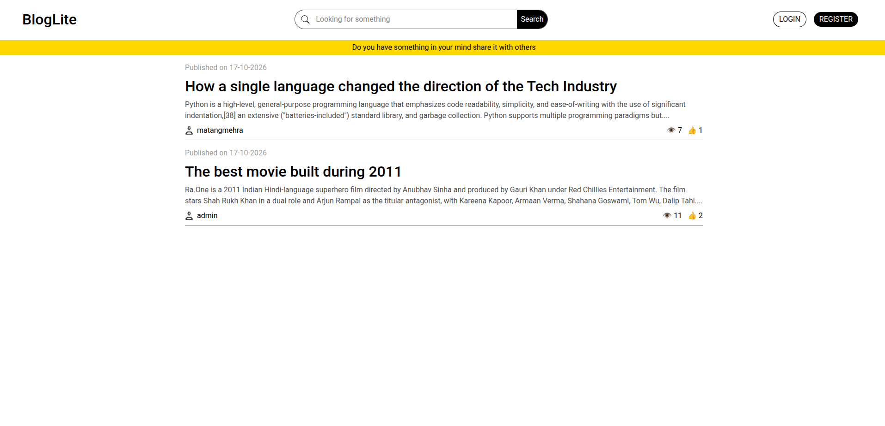
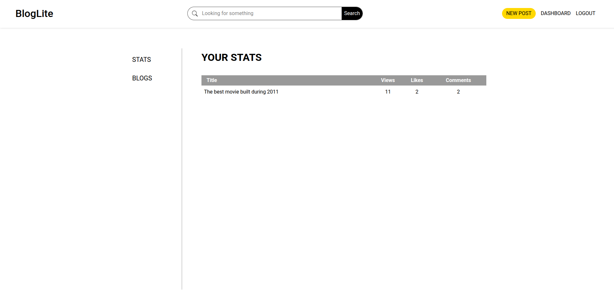
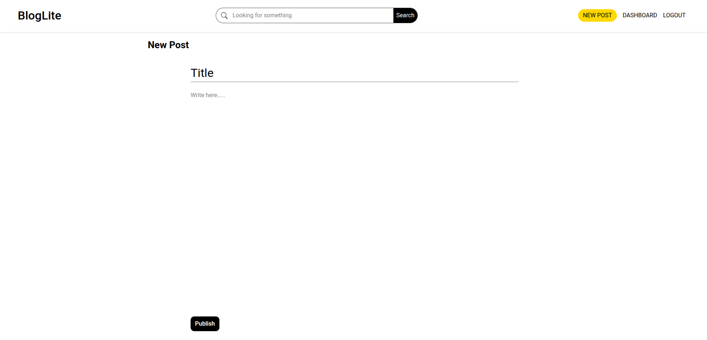
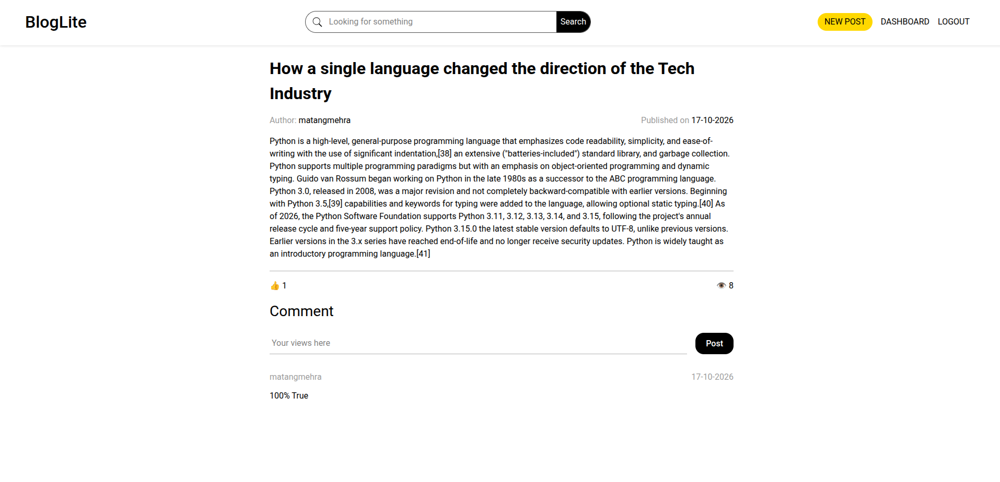

# BlogLite

BlogLite is a simple blog website where people can read posts, create new ones, and manage their writing in a clean and easy-to-use space. It is designed to feel light, friendly, and modern while keeping the experience simple for everyday users.

## About the project

This project is a small blog application built for sharing ideas, stories, and updates. Users can register, log in, and publish their own posts. The layout is designed to be easy to navigate, with a home page for reading posts and a dashboard area for writing and managing content.

## Features

- Simple blog homepage
- User registration and login
- Create new blog posts
- View and read posts easily
- Clean and minimal design
- Easy-to-use dashboard for content management

<!-- ## Demo site

Add the live demo link here:

Demo: [Your demo link here] -->

## Screenshot

